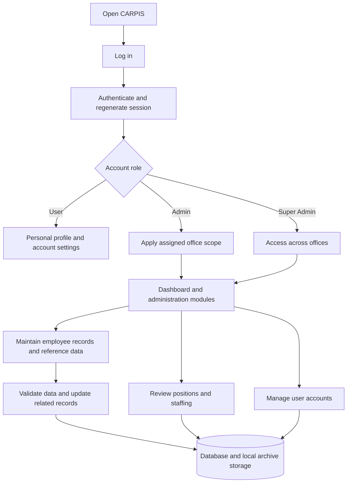

# DENR CARPIS

  

<strong>CAR Personnel Information System</strong>

## About the Project

CARPIS is a web application for managing personnel information for the Department of Environment and Natural Resources (DENR) in the Cordillera Administrative Region (CAR). It centralizes employee records, organizational assignments, plantilla positions, and user accounts for regional, provincial, and community offices.

Administrators maintain personnel records and monitor staffing through a dashboard, while employees can view their own profile and manage account settings. Office-based access controls support the Regional Office, Provincial Environment and Natural Resources Offices (PENROs), and Community Environment and Natural Resources Offices (CENROs).

## Features

- **Employee records:** Create, view, and update personal details, contact information, employment status, office assignments, education, eligibility, and appointment details.
- **Search and filtering:** Find employees by name and filter records by assignment, division or section, employment status, and position.
- **Position tracking:** View position item codes, salary grades, vacancy status, and occupant details. Employee forms filter available positions by organizational unit and automatically fill the salary grade.
- **Position history:** Record changes in employee position assignments, including archive and restoration events.
- **Archiving and restoration:** Archive employee and user records and restore them through dedicated archive views.
- **Excel import and download:** Import `.xlsx` and `.xls` employee workbooks with batch progress, created/updated/failed counts, and error feedback. Download an Excel workbook using the current employee filters.
- **Reference data:** Maintain organizational units, positions, salary grades, and assignment places through the employee module.
- **Dashboard:** Display staffing totals, filled and vacant positions, and personnel charts within the administrator's permitted office scope.
- **User administration:** Create and update accounts, manage roles and office scopes, and archive or restore users.
- **Account settings:** Provide login, registration, password reset, profile settings, password changes, and appearance preferences.

The repository also contains inventory and reporting components. Current web routes expose an inventory tag endpoint, but do not expose the full inventory management or reporting modules.

## Technology Stack

| Layer | Technologies |
| --- | --- |
| Backend | PHP 8.2+, Laravel 12, Eloquent ORM |
| Frontend | Vue 3, TypeScript, Inertia.js 2 |
| Styling and UI | Tailwind CSS 4, Reka UI, Lucide icons |
| Build tools | Vite 7, Laravel Vite plugin, npm, Composer |
| Database | Laravel database connections, including MySQL and SQLite; `.env.example` defaults to SQLite |
| Charts | Chart.js, Vue Chart.js |
| Excel processing | PhpSpreadsheet |
| QR codes | Endroid QR Code for inventory tags |
| Sessions, cache, and queues | Laravel services; `.env.example` uses database-backed drivers |
| Testing and formatting | Pest 3, Laravel testing tools, Laravel Pint, ESLint, Prettier |

Dependency requirements are defined in [composer.json](composer.json) and [package.json](package.json). Database selection is configured through the environment and [config/database.php](config/database.php).

## System Workflow

1. **Sign in:** The system authenticates the account and sends it toward the dashboard. The admin middleware redirects ordinary users to their personal profile.
2. **Apply access scope:** Admin accounts work within their assigned office scope. Super Admin accounts can access records across offices.
3. **Maintain personnel:** Select an office and organizational unit, choose an available position, and enter employee details. The backend validates the submission and maintains linked records and position occupancy.
4. **Import or download records:** Upload an Excel workbook and process it in batches with progress and error feedback, or download a workbook for the selected employee records.
5. **Archive or restore:** Move records into archive storage or restore them, updating position availability and history as applicable.
6. **Monitor staffing:** Review dashboard summaries and position listings for the permitted organizational scope.

Additional diagrams are available in [docs/PROJECT_FLOWCHART.md](docs/PROJECT_FLOWCHART.md). The workflow above follows the current routes and controllers.

## Security & Access

| Role | Stored value (`is_admin`) | Access |
| --- | --- | --- |
| User | `0` | Own personnel profile and account settings |
| Admin | `2` | Dashboard, employee records, positions, and user administration within the assigned office scope |
| Super Admin | `1` | Administration across offices, including assigning account roles |

Office scope is resolved from the account's `office_scope`, with a fallback to the employee assignment linked by email. PENRO scopes include their configured subordinate CENRO offices. These relationships are defined in [config/organizational_scope.php](config/organizational_scope.php).

Implemented controls include:

- Session authentication and admin middleware for administrative routes.
- Password hashing, login attempt throttling, session regeneration on login, and session invalidation on logout.
- Laravel web middleware protections, including CSRF validation for web form submissions.
- Server-side validation and organizational scope checks for personnel and user operations.
- Import ownership checks, file type and size validation, and locking to prevent concurrent processing of the same import.
- Password confirmation, password reset, and throttled password update routes.

Profile and administrative routes declare Laravel's `verified` middleware, and email verification routes are present. However, the current `User` model does not implement `MustVerifyEmail`, so the middleware does not currently enforce email verification. Account settings require authentication, and the inventory tag route is declared outside the authenticated route group.

## Source Code Availability

The configured source repository is [Pammyrose/carpis on GitHub](https://github.com/Pammyrose/carpis). Access depends on the repository owner's visibility and permissions.

| Directory | Contents |
| --- | --- |
| `app/` | Controllers, models, middleware, services, and jobs |
| `resources/js/` | Vue pages, components, layouts, and TypeScript code |
| `resources/css/` | Application styles |
| `routes/` | Web, authentication, settings, and console routes |
| `database/` | Migrations, seeders, and factories |
| `config/` | Application configuration and organizational scope mapping |
| `public/` | Public entry point, logos, and static assets |
| `tests/` | Feature and unit tests |
| `docs/` | Workflow documentation and diagram sources |

Use `.env.example` as the configuration template. Keep actual environment credentials and personnel data out of shared source code.
