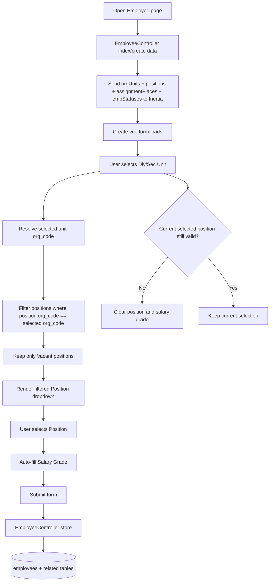

# CARPIS Project Flowchart

This document summarizes the main application flow based on current route definitions and major controllers.

## 1) Overall Request Flow

```mermaid
flowchart TD
    A[User opens app] --> B[/ GET / ]
    B --> C[Inertia renders auth/Login]

    C --> D{Authenticated?}
    D -- No --> E[Guest routes]
    E --> E1[Login]
    E --> E2[Register]
    E --> E3[Forgot/Reset Password]

    D -- Yes --> F{Verified?}
    F -- No --> G[Email verification flow]
    F -- Yes --> H{Admin?}

    H -- No --> I[User profile page /profile]
    I --> J[Settings routes]

    H -- Yes --> K[Admin routes]
    K --> K1[Dashboard]
    K --> K2[Employee module]
    K --> K3[Users module]
    K --> K4[Org Unit / Position / Assignment endpoints]

    K2 --> L[EmployeeController]
    K3 --> M[UsersController]
    K1 --> N[DashboardController]

    L --> O[(MySQL tables)]
    M --> O
    N --> O
```

## 2) Employee Create Flow (with unit-based position filtering)



## 3) Employee Module Route Flow

```mermaid
flowchart LR
    A[/employee] --> B[index]
    C[/employee/create] --> D[create]
    E[POST /employee] --> F[store]
    G[/employee/{id}/edit] --> H[edit]
    I[PUT /employee/{id}] --> J[update]
    K[DELETE /employee/{id}] --> L[destroy]
    M[/employee/archived] --> N[archived]
    O[POST /employee/{id}/unarchive] --> P[unarchive]

    D --> R[getDropdownData]
    R --> S[orgUnits]
    R --> T[positions]
    R --> U[assignmentPlaces]
    R --> V[empStatuses]
```

## Notes

- The flowcharts above are route-driven and controller-driven views of the current codebase.
- There is a route for inventory tag at /inventory/tag/{inventory}; other inventory controller actions exist in code but are not currently declared in routes/web.php.

## PNG Export Workflow

1. Install Node dependencies (includes Mermaid CLI):

```bash
npm install
```

2. Export all flowcharts to PNG:

```bash
npm run flowchart:png
```

3. Export a single chart if needed:

```bash
npm run flowchart:png:overall
npm run flowchart:png:create
npm run flowchart:png:routes
```

Generated files:

- docs/flowcharts/overall-request-flow.png
- docs/flowcharts/employee-create-flow.png
- docs/flowcharts/employee-route-flow.png

Mermaid source files:

- docs/flowcharts/overall-request-flow.mmd
- docs/flowcharts/employee-create-flow.mmd
- docs/flowcharts/employee-route-flow.mmd
